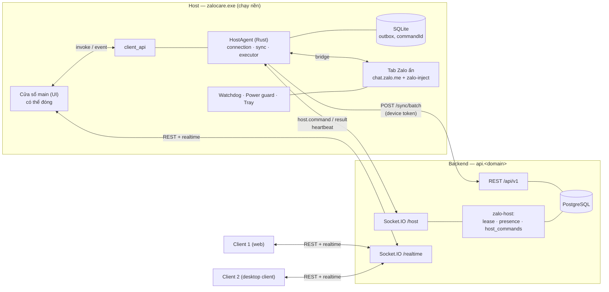
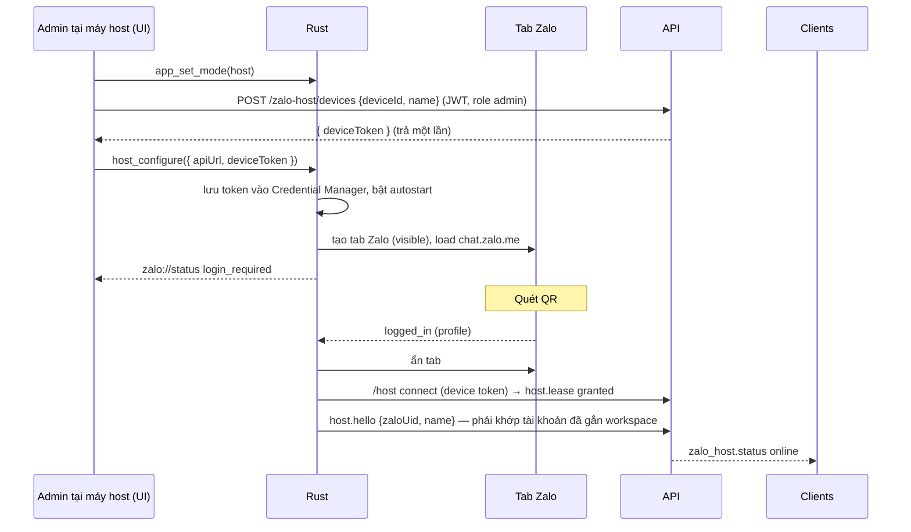
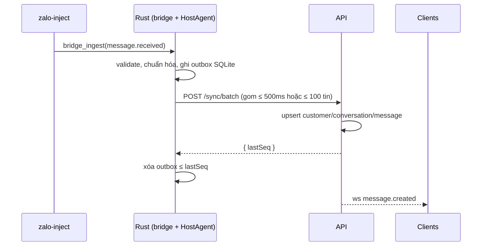
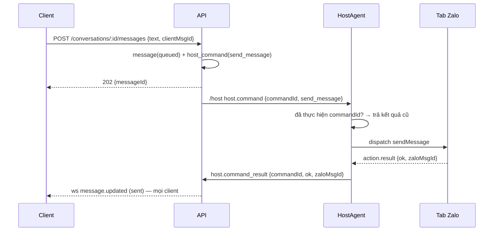

# Kiến trúc

## 1. Mô hình Host – Client

```text
1 workspace  =  1 tài khoản Zalo  =  1 Host (desktop, chạy nền)  +  N Client (web/desktop)
```

| Vai trò | Là gì | Làm gì |
|---|---|---|
| **Host** | App desktop Tauri ở chế độ host. **Mỗi app chỉ giữ 1 tài khoản Zalo**; mỗi workspace chỉ có **1 host hoạt động** | Chạy nền 24/7 (tray, tự khởi động): tab Zalo Web ẩn + **HostAgent Rust** đồng bộ tin lên backend và thực hiện lệnh từ backend |
| **Client** | Trình duyệt mở `app.<domain>` hoặc desktop ở chế độ client | Nhân viên CSKH đọc/trả lời khách. Mọi thao tác Zalo đi **qua backend tới host** |
| **Backend** | NestJS + PostgreSQL + Socket.IO tại `api.<domain>` | Lưu dữ liệu, phân quyền, hàng đợi lệnh, trung chuyển client → host, realtime |

Client không kết nối trực tiếp tới host (host nằm sau NAT). Backend là điểm hẹn. Người dùng ngồi tại máy host cũng chỉ là một client như mọi người khác.



## 2. Nguyên tắc

1. **Backend là nguồn dữ liệu chuẩn.** Mọi người (kể cả máy host) đọc/ghi hội thoại qua API.
2. **Chỉ HostAgent chạm vào Zalo**, qua tab Zalo + zalo-inject. Frontend không truy cập DOM/cookie Zalo.
3. **Logic host chạy trong Rust, không phụ thuộc cửa sổ** → không bị throttle, chạy được khi đóng UI ([ADR 0005](decisions/0005-background-host.md), [HOST_RUNTIME.md](HOST_RUNTIME.md)).
4. **Cookie/phiên Zalo không rời máy host.** Rust chỉ giữ **device token** phạm vi host (Windows Credential Manager).
5. **Lệnh tới Zalo đi qua hàng đợi ở backend** (`host_commands`): có trạng thái, idempotent, TTL, rate limit.
6. **Dữ liệu chưa đồng bộ nằm trong SQLite outbox** → tắt máy đột ngột không mất tin.
7. **Contract có phiên bản ở mọi ranh giới** (`packages/contracts`): bridge, http, realtime, host.

## 3. Trách nhiệm thành phần

### `apps/desktop` — Tauri + Rust

Một bộ cài, hai chế độ (chọn khi thiết lập): **Host** (tab Zalo + HostAgent + chạy nền) hoặc **Client** (chỉ cửa sổ main).

| Module | Trách nhiệm |
|---|---|
| `app/` | Setup, single-instance, updater, cửa sổ main trỏ `APP_URL`, chế độ host/client, `app/tray` |
| `client_api/` | Command/event cho UI: thiết lập host, trạng thái, hiện tab Zalo, cài đặt nền — [CLIENT_API.md](CLIENT_API.md) |
| `zalo/window` | Tab `zalo` duy nhất, profile cố định, cờ chống throttling, ẩn/hiện |
| `zalo/session` | Trạng thái phiên Zalo, profile tài khoản, phát hiện đổi tài khoản |
| `zalo/bridge` | `bridge_ingest` từ zalo-inject (validate, rate limit) và `dispatch` action vào tab |
| `zalo/adapter` | Chuẩn hóa dữ liệu thô → `ZaloMessage`, `ZaloThread` |
| `host_agent/credentials` | Device token trong Credential Manager |
| `host_agent/connection` | Socket.IO `/host`: lease, heartbeat, reconnect |
| `host_agent/sync` | Outbox → `POST /sync/batch` |
| `host_agent/executor` | `host.command` → action Zalo → `host.command_result`, chống trùng `commandId` |
| `background/power` | Tắt EcoQoS, giữ máy không ngủ (tùy chọn) |
| `background/watchdog` | Theo dõi heartbeat tab Zalo, reload/tạo lại khi treo |
| `background/autostart` | Tự khởi động cùng Windows ở chế độ nền |
| `storage/` | SQLite: settings, outbox, commandId đã thực hiện |

`zalo-inject` (TypeScript → 1 file JS, inject bằng `initialization_script`): `observers/` (auth, threads, messages, heartbeat), `actions/` (sendMessage, openThread, loadHistory), `selectors/` (selector Zalo Web + `SELECTOR_VERSION`), `transport/`.

### `apps/web` — Vite + React

Một build cho mọi người; host và client dùng **chung một luồng** qua API.

- `features/*` CSKH: inbox, customers, tags, assignments, reminders, reports, settings.
- `features/zalo-host`:
  - trên máy host (desktop chế độ host): màn thiết lập host, quét QR, trạng thái HostAgent/tab Zalo, cài đặt chạy nền — dùng `lib/bridge`;
  - trên mọi client: badge trạng thái host (online/offline, cần quét QR) từ realtime.
- `lib/bridge` — adapter duy nhất gọi Tauri; `isDesktop`, `isHost`.
- `lib/api`, `lib/realtime` — REST + Socket.IO `/realtime`.

### `apps/api` — NestJS

- Module: `auth, users, workspaces, zalo-host, sync, conversations, messages, customers, tags, assignments, notes, reminders, quick-replies, activities, audit, realtime, health`.
- **`zalo-host`**: tài khoản Zalo (1–1 workspace), **device token** của host, **lease** (1 host hoạt động), presence, `host_commands` + dispatcher + rate limiter.
- **`realtime`**: 2 namespace Socket.IO:
  - `/realtime` — người dùng (JWT), phòng `ws:<workspaceId>`, `conv:<id>`;
  - `/host` — HostAgent (device token), phòng `host:<workspaceId>`.

## 4. Luồng chính

### 4.1 Thiết lập host (một lần)



Từ đó, mỗi lần Windows khởi động: app chạy `--background`, tab Zalo dùng lại phiên, HostAgent tự kết nối — không cần ai thao tác.

### 4.2 Tin nhắn đến



### 4.3 Client trả lời khách



- **Host offline**: lệnh `queued`, client thấy "Host offline — tin sẽ gửi khi host kết nối lại"; quá `HOST_COMMAND_TTL` → `expired`.
- Host kết nối lại → backend đẩy lại lệnh `queued` theo thứ tự.
- Tin chủ tài khoản gửi từ điện thoại cũng được observer bắt (`direction: out`) và đồng bộ.

### 4.4 Tải lịch sử

Client → `POST /conversations/:id/load-history` → `host_command(load_history)` → HostAgent → zalo-inject → dữ liệu quay về theo luồng 4.2.

## 5. Môi trường

| Môi trường | Web | API | Desktop tải |
|---|---|---|---|
| local | `http://localhost:5173` | `http://localhost:3000` | Vite local |
| staging | `https://app.staging.<domain>` | `https://api.staging.<domain>` | `APP_URL` staging |
| production | `https://app.<domain>` | `https://api.<domain>` | `https://app.<domain>` |

Xem thêm: [ADR 0003](decisions/0003-hosted-frontend.md) (desktop tải frontend từ tên miền), [ADR 0004](decisions/0004-host-client-model.md) (host–client), [ADR 0005](decisions/0005-background-host.md) (chạy nền), [DEPLOYMENT.md](DEPLOYMENT.md).
