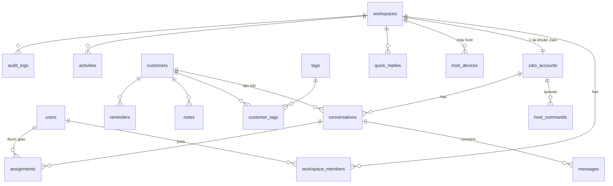

# Mô hình dữ liệu

PostgreSQL 16+, quản lý bằng Prisma (`apps/api/prisma/schema.prisma`). Quy ước:

- Khóa chính `id uuid` (v7), `created_at`, `updated_at` trên mọi bảng; xóa mềm bằng `deleted_at` với dữ liệu nghiệp vụ.
- Mọi bảng nghiệp vụ có `workspace_id` → index kép `(workspace_id, …)`; API luôn lọc theo workspace.
- Tên bảng/cột `snake_case`, số nhiều cho bảng.

## Sơ đồ

## Bảng

| Bảng | Cột chính | Ghi chú |
|---|---|---|
| `users` | email (unique), password_hash, name, avatar_url, status | Tài khoản đăng nhập ZaloCare |
| `refresh_tokens` | user_id, token_hash, device, expires_at, revoked_at | Lưu **hash**, xoay vòng mỗi lần refresh |
| `workspaces` | name, slug, plan, settings jsonb | Tenant |
| `workspace_members` | workspace_id, user_id, role (`owner\|admin\|agent\|viewer`) | Unique (workspace_id, user_id) |
| `zalo_accounts` | workspace_id (**unique**), zalo_uid, display_name, avatar_url, active_host_device_id, host_lease_until, host_last_seen_at, zalo_state | 1 workspace = 1 tài khoản Zalo = 1 host. `host_*` là lease của host đang hoạt động |
| `host_devices` | workspace_id, device_id (unique), name, token_hash, created_by, last_seen_at, revoked_at | Máy được cấp quyền làm host; token chỉ lưu **hash** |
| `host_commands` | workspace_id, zalo_account_id, type, payload jsonb, status (`queued\|dispatched\|done\|failed\|expired`), requested_by, message_id?, attempts, error, expires_at, dispatched_at, done_at | Hàng đợi lệnh client → host. Idempotent theo `id` (= commandId). Index (zalo_account_id, status, created_at) |
| `customers` | workspace_id, full_name, phone, email, zalo_uid, avatar_url, stage, owner_user_id, custom_fields jsonb, last_interaction_at | Hồ sơ CRM; `stage` là pipeline (`new, contacted, qualified, won, lost`…) |
| `conversations` | workspace_id, zalo_account_id, zalo_thread_id, kind, customer_id?, title, status (`open\|pending\|closed`), unread_count, last_message_at | Unique (zalo_account_id, zalo_thread_id) |
| `messages` | workspace_id, conversation_id, zalo_msg_id, client_msg_id, direction, sender_uid, kind, text, attachments jsonb, sent_at, status (`queued\|dispatched\|sent\|failed\|expired\|recalled`), sent_by_user_id? | Unique (conversation_id, zalo_msg_id) → upsert idempotent; partition theo tháng khi lớn |
| `tags` | workspace_id, name, color | |
| `customer_tags` | customer_id, tag_id | PK kép |
| `assignments` | conversation_id, user_id, assigned_by, assigned_at, unassigned_at | Lịch sử phân công; hiện hành = `unassigned_at IS NULL` |
| `notes` | workspace_id, customer_id, author_id, body | |
| `reminders` | workspace_id, customer_id, assignee_id, due_at, title, done_at | Nhắc việc follow-up |
| `quick_replies` | workspace_id, shortcut, body, created_by | Mẫu trả lời nhanh, gõ `/shortcut` |
| `activities` | workspace_id, actor_id, subject_type, subject_id, verb, data jsonb | Timeline nghiệp vụ hiển thị cho người dùng |
| `audit_logs` | workspace_id, actor_id, action, target, ip, user_agent, data jsonb | Thao tác nhạy cảm (đổi quyền, xuất dữ liệu, xóa). Append-only |
| `sync_cursors` | zalo_account_id, device_id, last_seq, updated_at | Tiến độ đồng bộ của host (theo thiết bị, giữ lại khi takeover) |

## Index quan trọng

- `messages (conversation_id, sent_at DESC)` — tải lịch sử.
- `conversations (workspace_id, status, last_message_at DESC)` — inbox.
- `customers (workspace_id, phone)`, `customers (workspace_id, zalo_uid)` — ghép khách hàng.
- Tìm kiếm: `pg_trgm` trên `customers.full_name`, `messages.text` (cân nhắc full-text tiếng Việt `unaccent`).

## Lưu giữ dữ liệu

- Nội dung tin nhắn là dữ liệu cá nhân → cấu hình thời hạn lưu theo workspace (`settings.retention_days`), job dọn dẹp hằng ngày.
- File đính kèm: chỉ lưu URL/metadata ở M5; lưu trữ file (S3-compatible) là quyết định riêng.
